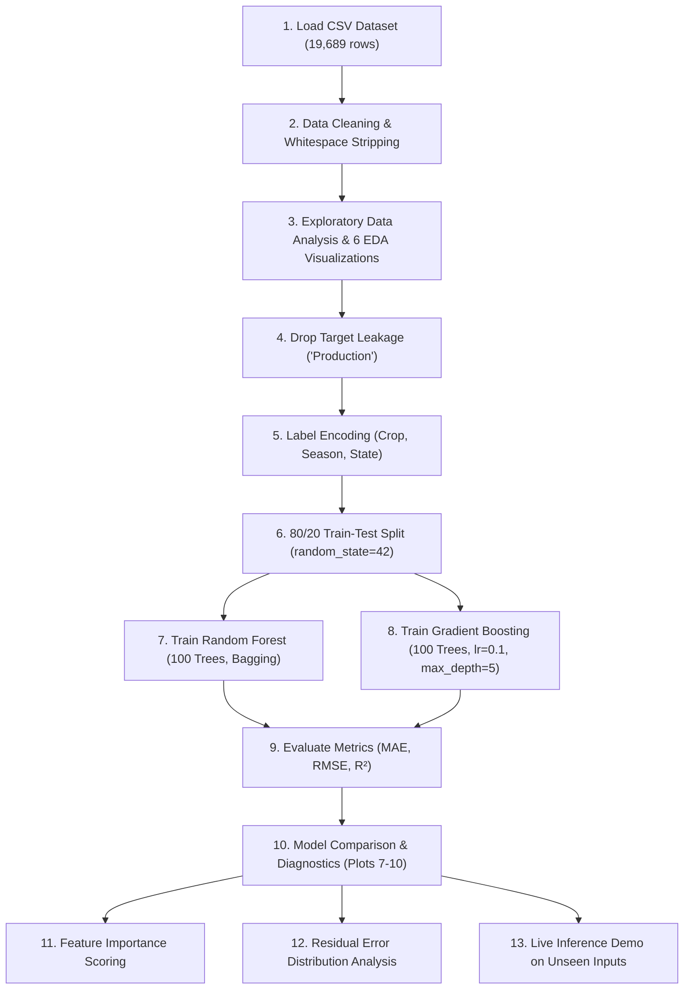

# 🌾 Crop Yield Prediction Using Machine Learning & Flask Dashboard

[](https://www.python.org/)
[](https://scikit-learn.org/)
[](https://flask.palletsprojects.com/)
[](https://pandas.pydata.org/)
[](#machine-learning-pipeline)
[](#)

An end-to-end Machine Learning and precision agriculture system designed to accurately forecast crop yields (in metric tons per hectare) across Indian states. The project benchmarks two powerful ensemble learning algorithms (**Random Forest Regressor** and **Gradient Boosting Regressor**), generates 10 comprehensive analytical plots, and provides an interactive, dark-mode **Flask web application** for real-time predictions and model management.

---

## 📑 Table of Contents

- [Project Overview](#-project-overview)
- [Key Features](#-key-features)
- [Repository Structure](#-repository-structure)
- [Dataset Description](#-dataset-description)
- [Machine Learning Pipeline](#-machine-learning-pipeline)
- [Model Performance & Evaluation](#-model-performance--evaluation)
- [Visualizations & Analytical Insights](#-visualizations--analytical-insights)
- [Interactive Web Application](#-interactive-web-application)
- [Installation & Setup](#-installation--setup)
- [How to Run](#-how-to-run)
  - [1. Standalone ML Pipeline (CLI)](#1-standalone-ml-pipeline-cli)
  - [2. Interactive Flask Web Application](#2-interactive-flask-web-application)
- [API Reference](#-api-reference)
- [Viva & Technical Examination Questions](#-viva--technical-examination-questions)
- [Future Enhancements](#-future-enhancements)
- [Author & Acknowledgments](#-author--acknowledgments)

---

## 🌟 Project Overview

Agriculture is the cornerstone of India's economy, yet crop output remains vulnerable to unpredictable climate patterns, varying agro-ecological regions, and resource allocations. Accurate crop yield estimation allows farmers, agronomists, insurance underwriters, and policymakers to:

1. **Optimize Resource Utilization**: Apply fertilizers and pesticides judiciously.
2. **Mitigate Financial Risk**: Improve agricultural insurance claims and yield loss protection.
3. **Plan Supply Chains & Markets**: Anticipate regional harvest volumes to stabilize consumer pricing.
4. **Support Precision Farming**: Tailor crop selection to specific climatic and regional conditions.

This project uses over two decades (1997–2020) of historical agricultural records covering **55 distinct crops** across **30 Indian states and union territories**. It formulates the prediction as a **Supervised Regression** task and implements a full lifecycle: exploratory data analysis (EDA), data cleaning, target leakage prevention, ensemble model training, hyperparameter tuning, residual diagnostics, and full-stack web deployment.

---

## 🚀 Key Features

- **Dual Ensemble Algorithms**: Directly compares **Random Forest** (bagging) and **Gradient Boosting** (sequential boosting) algorithms.
- **High Predictive Accuracy**: Reaches **$R^2 \approx 0.978$** (explaining over 97.7% of the variance in crop yield on unseen testing data).
- **Target Leakage Safeguard**: Identifies and drops the `Production` feature during training because $\text{Yield} = \frac{\text{Production}}{\text{Area}}$, preventing artificial data leakage and ensuring authentic real-world generalization.
- **10 Diagnostic Visualizations**: Generates and persists high-resolution exploratory, correlation, trend, actual vs. predicted, feature weight, and error distribution charts.
- **Interactive Flask Web Dashboard**:
  - Glassmorphic UI with dynamic cascading dropdowns populated from dataset records.
  - Asynchronous (AJAX) dual-model yield predictions without page refreshes.
  - Interactive tabs showing dynamically generated Matplotlib charts converted on-the-fly to base64 images.
  - In-browser model retraining via dedicated API.
  - Interactive dataset preview and statistical summary table.
- **Academic & Exam Ready**: Includes a comprehensive **30+ Viva Voce Question Bank** ([VIVA_QUESTIONS.md](file:///c:/Old%20Laptop/Skips%20University%20code/Sem%202/Machine%20Learning/crop-yield-prediction/VIVA_QUESTIONS.md)) and formal documentation.

---

## 📂 Repository Structure

```text
crop-yield-prediction/
│
├── crop_yield_data.csv                    # Historical dataset (19,689 rows, 1997-2020)
├── crop_yield_prediction.py               # Standalone 13-step ML pipeline script
├── app.py                                 # Flask web application controller & server
├── requirements.txt                       # Project dependencies
├── README.md                              # Complete project documentation
├── VIVA_QUESTIONS.md                      # Detailed technical Q&A guide for viva/interviews
├── Crop_Yield_Prediction_Documentation.docx# Formal Word report documentation
│
├── templates/
│   └── index.html                         # Modern dashboard UI (HTML5, CSS3, JavaScript)
│
├── uploads/                               # Working directory for file handling
│
└── Visualizations (Generated Output Plots):
    ├── plot_1_yield_distribution.png      # Target variable distribution & KDE curve
    ├── plot_2_correlation_heatmap.png     # Pearson correlation matrix of numeric parameters
    ├── plot_3_top_crops.png               # Top 10 crops by average yield
    ├── plot_4_rainfall_vs_yield.png       # Scatter plot of annual rainfall impact
    ├── plot_5_fertilizer_vs_yield.png     # Scatter plot of chemical fertilizer usage
    ├── plot_6_yield_over_years.png        # Historical yield progression (1997 - 2020)
    ├── plot_7_model_comparison.png        # Bar chart comparing MAE, RMSE, and R2
    ├── plot_8_actual_vs_predicted.png     # Actual vs. predicted scatter plots for both models
    ├── plot_9_feature_importance.png      # Feature importance rankings
    └── plot_10_residual_analysis.png      # Residual (error) density distribution
```

---

## 📊 Dataset Description

The dataset used is the **Agricultural Crop Yield in Indian States Dataset**, capturing agricultural yield metrics from **1997 to 2020**.

- **Total Records**: 19,689 samples
- **Total Columns**: 10 attributes
- **Target Variable**: `Yield` ($\text{Production} / \text{Area}$, measured in Metric Tons per Hectare)
- **Crops Represented**: 55 unique varieties (e.g., Rice, Wheat, Sugarcane, Coconut, Maize, Arecanut, Cotton, etc.)
- **States & UTs**: 30 states/regions across India (e.g., Assam, Punjab, Uttar Pradesh, Tamil Nadu, Maharashtra, etc.)
- **Seasons**: 6 categories (`Kharif`, `Rabi`, `Whole Year`, `Summer`, `Autumn`, `Winter`)

### Attribute Breakdown

| Column Name | Data Type | Units / Scale | Description |
|---|---|---|---|
| `Crop` | Categorical | Text (55 classes) | Botanical name or common crop type |
| `Crop_Year` | Numeric (Int) | 1997 – 2020 | Harvest / agricultural calendar year |
| `Season` | Categorical | Text (6 classes) | Cropping seasonal window (e.g., Kharif, Rabi) |
| `State` | Categorical | Text (30 classes) | Indian state or territory where crop was cultivated |
| `Area` | Numeric (Float) | Hectares | Land surface area under cultivation |
| `Production` | Numeric (Float) | Metric Tons | Total gross crop output (*dropped during ML training*) |
| `Annual_Rainfall` | Numeric (Float) | Millimeters (mm) | Cumulative yearly precipitation recorded in region |
| `Fertilizer` | Numeric (Float) | Kilograms (kg) | Total synthetic fertilizer applied |
| `Pesticide` | Numeric (Float) | Kilograms (kg) | Total pesticide and chemical protectant applied |
| **`Yield`** *(Target)* | Numeric (Float) | Tons / Hectare | Crop output efficiency ($\text{Yield} = \frac{\text{Production}}{\text{Area}}$) |

> [!IMPORTANT]
> **Data Leakage Prevention**: In real agricultural deployment, total `Production` is unknown before harvesting — it is the very outcome being estimated! Because $\text{Yield} = \frac{\text{Production}}{\text{Area}}$, retaining `Production` as an input would artificially allow the model to cheat through simple division. Dropping `Production` forces the models to learn real predictive patterns from regional, seasonal, environmental, and chemical variables.

---

## ⚙️ Machine Learning Pipeline

The project follows a modular, 13-step machine learning workflow implemented in [crop_yield_prediction.py](file:///c:/Old%20Laptop/Skips%20University%20code/Sem%202/Machine%20Learning/crop-yield-prediction/crop_yield_prediction.py):



### Detailed Steps

1. **Step 1 - Environment & Library Setup**: Imports `numpy`, `pandas`, `matplotlib`, `seaborn`, and `scikit-learn`.
2. **Step 2 - Dataset Ingestion**: Reads `crop_yield_data.csv`, inspects shape, data types, and prints head samples.
3. **Step 3 - Exploratory Data Analysis (EDA)**: Checks for missing or null records (`df.isnull().sum()`), strips inconsistent whitespace padding from categorical strings, and computes summary statistics (`df.describe()`).
4. **Step 4 - Exploratory Visualizations**: Saves Plots 1 through 6 to disk.
5. **Step 5 - Preprocessing & Categorical Encoding**: Fits `sklearn.preprocessing.LabelEncoder` on `Crop`, `Season`, and `State`, saving encoders for inference. Drops `Production` to eliminate target leakage.
6. **Step 6 - Train-Test Splitting**: Splits data into 80% training (15,751 rows) and 20% test (3,938 rows) with `random_state=42`.
7. **Step 7 - Random Forest Regressor**:
   - `n_estimators=100`, `random_state=42`, `n_jobs=-1`.
   - Utilizes bagging (bootstrap aggregation) to train 100 decorrelated decision trees in parallel.
8. **Step 8 - Gradient Boosting Regressor**:
   - `n_estimators=100`, `learning_rate=0.1`, `max_depth=5`, `random_state=42`.
   - Constructs decision trees sequentially, optimizing residuals using gradient descent.
9. **Step 9 - Quantitative Metric Evaluation**: Evaluates Mean Absolute Error ($MAE$), Root Mean Squared Error ($RMSE$), and Coefficient of Determination ($R^2$).
10. **Step 10 - Actual vs. Predicted Diagnostics**: Plots dual scatter figures comparing actual yields against predicted outputs relative to the ideal reference line ($y = x$).
11. **Step 11 - Feature Importance Analysis**: Extracts MDI (Mean Decrease in Impurity) feature weights from both models.
12. **Step 12 - New Data Inference Demo**: Tests model predictions with an arbitrary new sample vector.
13. **Step 13 - Residual Error Distribution**: Examines error distributions ($e_i = y_i - \hat{y}_i$) with KDE curves to verify zero-centered, unbiased predictions.

---

## 📈 Model Performance & Evaluation

Both models were trained on the identical 80% split and tested against unseen test records (3,938 rows):

| Metric | Random Forest Regressor | Gradient Boosting Regressor | Best Performing |
|---|:---:|:---:|:---:|
| **Mean Absolute Error (MAE)** *(lower is better)* | **10.4305** | 11.7063 | 🏆 **Random Forest** |
| **Root Mean Squared Error (RMSE)** *(lower is better)* | **133.1387** | 133.4397 | 🏆 **Random Forest** |
| **Coefficient of Determination ($R^2$ Score)** *(higher is better)* | **0.9779** (97.79%) | **0.9778** (97.78%) | 🏆 **Random Forest** |

### Key Observations:
- **Random Forest Wins**: Random forest achieves a lower MAE (10.43 vs. 11.71) and slightly lower RMSE, indicating superior resistance to outliers and variance across diverse crops.
- **High Variance Explained**: An $R^2$ exceeding $0.977$ indicates that over 97.7% of variability in yield is successfully explained by the environmental, chemical, and geographic inputs.
- **Tree-Based Scale Invariance**: Because both algorithms rely on recursive partitioning at feature threshold splits, feature standardization (e.g. `StandardScaler` or `MinMaxScaler`) was unnecessary and omitted without loss of predictive power.

### Feature Importance Scores

| Rank | Feature | Random Forest Weight | Gradient Boosting Weight | Physical / Agricultural Interpretation |
|:---:|---|:---:|:---:|---|
| 1 | **`Crop`** | **84.75%** | **84.95%** | **Primary determinant**: Baseline yields vary fundamentally by plant biology (e.g., coconut/sugarcane generate dozens of tons/ha, while pulses yield < 1 ton/ha). |
| 2 | **`State`** | **9.89%** | **9.42%** | **Regional agro-climatic zone**: Soil profile, topography, local irrigation infrastructure, and latitude. |
| 3 | **`Pesticide`** | **1.36%** | **1.21%** | Protects crop biomass from pest-driven destruction. |
| 4 | **`Fertilizer`** | **1.24%** | **1.58%** | Chemical nutrition (NPK levels) driving plant growth. |
| 5 | **`Area`** | **1.08%** | **1.15%** | Farm size and economies of scale. |
| 6 | **`Crop_Year`** | **0.94%** | **0.86%** | Technological improvement and climate variation over 1997–2020. |
| 7 | **`Annual_Rainfall`** | **0.73%** | **0.83%** | Water availability during key growth phases. |
| 8 | **`Season`** | **< 0.01%** | **< 0.01%** | Cropping window (mostly accounted for by Crop & State pairings). |

---

## 🖼️ Visualizations & Analytical Insights

The project automatically produces 10 high-resolution analytical plots:

| Plot | Filename | Description | Key Insight |
|:---:|---|---|---|
| **1** | `plot_1_yield_distribution.png` | Histogram & KDE of Yield | Positive right-skewed distribution; majority of field crops yield between 0–10 tons/ha, while tree/plantation crops create a long upper tail. |
| **2** | `plot_2_correlation_heatmap.png` | Correlation matrix of numeric features | Highlights correlation between input variables (Fertilizer and Pesticide usage are strongly co-linear, $r \approx 0.90$). |
| **3** | `plot_3_top_crops.png` | Bar plot of Top 10 High-Yielding Crops | Plantation crops (e.g., Coconut, Sugarcane) achieve the highest biomass yield per hectare. |
| **4** | `plot_4_rainfall_vs_yield.png` | Scatter plot: Rainfall vs. Yield | Shows optimal rainfall threshold; excessive precipitation does not necessarily boost yield without proper drainage. |
| **5** | `plot_5_fertilizer_vs_yield.png` | Scatter plot: Fertilizer vs. Yield | Exhibits diminishing marginal returns of fertilizer beyond moderate thresholds. |
| **6** | `plot_6_yield_over_years.png` | Longitudinal trendline (1997–2020) | Demonstrates modern yield trends and technological progress over 23 years. |
| **7** | `plot_7_model_comparison.png` | Performance comparison bar chart | Side-by-side comparison of MAE and $R^2$ scores across Random Forest and Gradient Boosting. |
| **8** | `plot_8_actual_vs_predicted.png` | Actual vs. Predicted scatter plot | High concentration of points tight to the 45-degree dashed reference line ($y = x$), validating high fidelity. |
| **9** | `plot_9_feature_importance.png` | Ranked horizontal bar charts | Visual representation of feature importance rankings. |
| **10** | `plot_10_residual_analysis.png` | Residual error density curves | Symmetrical, zero-centered bell distribution verifying that model errors are unbiased. |

---

## 💻 Interactive Web Application

The repository includes a modern, production-grade Flask web application located in `app.py` and `templates/index.html`.

### Key Interface Capabilities

1. **Precision Yield Predictor Form**:
   - Dropdown selectors populated dynamically from the 55 unique crops, 30 states, and 6 seasons in the dataset.
   - Numeric inputs for Year, Cultivation Area (ha), Annual Rainfall (mm), Fertilizer (kg), and Pesticide (kg).
   - Instant dual predictions showing both Random Forest and Gradient Boosting estimates side by side.
2. **Model Retraining Engine**:
   - Includes a **"Retrain Models"** button that calls the `/train` endpoint asynchronously, refreshing models and figures without restarting the server.
3. **Analytical Graphics Dashboard**:
   - Interactive tabbed interface allowing users to toggle through all 10 analytical charts.
   - Plots are rendered dynamically using base64 encoding directly in memory (`Agg` backend), requiring no static file caching or browser refreshes.
4. **Dataset Preview Table**:
   - Live preview displaying dataset dimensions (19,689 rows $\times$ 10 columns) and the first 10 rows with formatted styling.

---

## 🛠️ Installation & Setup

### Prerequisites

- **Python**: Version 3.8, 3.9, 3.10, 3.11, or 3.12 installed
- **pip**: Python package manager
- **Git** (optional, for cloning)

### Step 1: Clone or Navigate to the Project Directory

```bash
cd "c:\Old Laptop\Skips University code\Sem 2\Machine Learning\crop-yield-prediction"
```

### Step 2: Create and Activate a Virtual Environment

#### On Windows (PowerShell):
```powershell
python -m venv venv
.\venv\Scripts\Activate.ps1
```

#### On Windows (Command Prompt):
```cmd
python -m venv venv
.\venv\Scripts\activate.bat
```

#### On Linux / macOS:
```bash
python3 -m venv venv
source venv/bin/activate
```

### Step 3: Install Required Dependencies

```bash
pip install -r requirements.txt
```

#### Installed Libraries:
- `pandas` - Data manipulation and CSV ingestion
- `numpy` - Vector operations and numerical computing
- `matplotlib` - Figure generation and plot export
- `seaborn` - Statistical visualization and styling
- `scikit-learn` - Machine learning models, splitters, encoders, and evaluation metrics
- `Flask` - Web application server and REST endpoints

---

## 🏃 How to Run

### 1. Standalone ML Pipeline (CLI)

To execute the entire 13-step machine learning pipeline from the command line, train the models, output performance metrics to the terminal, and save all 10 PNG charts:

```bash
python crop_yield_prediction.py
```

**Expected Terminal Output:**
```text
--- Step 1: Importing Necessary Libraries ---
--- Step 2: Loading the Kaggle Dataset ---
Dataset successfully loaded. Shape: 19689 rows, 10 columns
--- Step 3: Exploratory Data Analysis (EDA) ---
Perfect! No missing values found in the dataset.
--- Step 4: Generating Exploratory Visualizations ---
Saved: plot_1_yield_distribution.png ... plot_6_yield_over_years.png
--- Step 5: Data Preprocessing & Categorical Encoding ---
Dropping 'Production' to prevent data leakage...
--- Step 6: Train-Test Split (80/20) ---
Training set size: 15751 rows | Testing set size: 3938 rows
--- Step 7: Training Random Forest Regressor ---
Random Forest Results on Test Set:
MAE: 10.4305 | RMSE: 133.1387 | R^2: 0.9779
--- Step 8: Training Gradient Boosting Regressor ---
Gradient Boosting Results on Test Set:
MAE: 11.7063 | RMSE: 133.4397 | R^2: 0.9778
--- Step 9: Model Performance Comparison ---
WINNER: Random Forest Regressor (R^2 = 0.9779)
Saved: plot_7_model_comparison.png ... plot_10_residual_analysis.png
*** ML Crop Yield Prediction script completed successfully! ***
```

---

### 2. Interactive Flask Web Application

To launch the web interface:

```bash
python app.py
```

1. Open your web browser and navigate to:
   ```text
   http://127.0.0.1:5000
   ```
2. You will be greeted by the **Crop Yield Prediction & ML Workbench** dashboard.
3. Select your desired crop, state, season, and input environmental variables to generate instant predictions!

---

## 🔌 API Reference

The Flask application exposes the following endpoints:

### `GET /`
- **Description**: Serves the main web dashboard with dataset preview, performance metrics, and pre-rendered plots.
- **Response**: Rendered HTML page (`index.html`).

### `POST /predict`
- **Description**: Accepts form data with agricultural parameters and returns yield predictions from both models.
- **Request Body** (`multipart/form-data` or `application/x-www-form-urlencoded`):
  - `crop` *(string)*: e.g., `"Wheat"`
  - `year` *(integer)*: e.g., `2024`
  - `season` *(string)*: e.g., `"Rabi"`
  - `state` *(string)*: e.g., `"Punjab"`
  - `area` *(float)*: e.g., `12000`
  - `rainfall` *(float)*: e.g., `1200`
  - `fertilizer` *(float)*: e.g., `450000`
  - `pesticide` *(float)*: e.g., `1800`
- **Response** (`application/json`):
  ```json
  {
    "success": true,
    "rf_pred": 3.4215,
    "gb_pred": 3.3981,
    "crop": "Wheat",
    "state": "Punjab"
  }
  ```

### `POST /train`
- **Description**: Triggers an in-memory retraining of both Random Forest and Gradient Boosting models, recalculates evaluation metrics, and updates dynamic visualization buffers.
- **Response** (`application/json`):
  ```json
  {
    "success": true,
    "message": "Models and visual plots re-evaluated successfully!"
  }
  ```

---

## 🎓 Viva & Technical Examination Questions

For in-depth viva voce, lab exam, or interview preparation, refer to the included [VIVA_QUESTIONS.md](file:///c:/Old%20Laptop/Skips%20University%20code/Sem%202/Machine%20Learning/crop-yield-prediction/VIVA_QUESTIONS.md).

### Quick Cheat Sheet

| Question | Core Concept | Summary Answer |
|---|---|---|
| **Why is this a regression task?** | Machine Learning Taxonomy | We predict continuous numerical values (tons/ha), not discrete classification labels. |
| **Why was `Production` dropped?** | Data Leakage Prevention | $\text{Yield} = \frac{\text{Production}}{\text{Area}}$. Keeping `Production` causes target leakage where the model trivially computes division rather than learning agricultural dependencies. |
| **Why Random Forest over a single Decision Tree?** | Ensemble Learning | A single decision tree has high variance and overfits. Random Forest builds 100 decorrelated trees via bootstrap aggregation and averages their predictions to reduce variance. |
| **Bagging vs. Boosting?** | Ensemble Paradigms | **Bagging (Random Forest)** trains multiple independent trees in parallel and averages results. **Boosting (Gradient Boosting)** trains trees sequentially, with each new tree minimizing the residual errors of preceding trees. |
| **Why not use `StandardScaler`?** | Feature Scaling | Tree-based algorithms split nodes based on threshold criteria ($x_j \le \theta$). Monotonic scale transformations do not change split rankings. |
| **What does $R^2 = 0.978$ mean?** | Goodness of Fit | Approximately 97.8% of variance in crop yield is successfully explained by the trained model on unseen test data. |

---

## 🔮 Future Enhancements

- [ ] **Live Weather API Integration**: Ingest real-time rainfall, temperature, and humidity forecasts via the OpenWeatherMap or IMD (India Meteorological Department) APIs.
- [ ] **Soil Nutrient Profile**: Incorporate soil chemical properties such as Nitrogen (N), Phosphorus (P), Potassium (K), and pH levels.
- [ ] **Advanced Model Architectures**: Experiment with XGBoost, LightGBM, CatBoost, and Deep Neural Networks (MLP / TabNet).
- [ ] **Satellite Imagery & Remote Sensing**: Integrate NDVI (Normalized Difference Vegetation Index) from Sentinel-2 satellite data.
- [ ] **Containerization & Cloud Deployment**: Package the Flask application with Docker and deploy to AWS Elastic Beanstalk or Google Cloud Run.

---

## 👨‍💻 Author & Acknowledgments

- **Course**: Machine Learning Laboratory (Semester 2)
- **Dataset**: Kaggle - *Agricultural Crop Yield in Indian States Dataset* (1997–2020)
- **Libraries**: Scikit-Learn, Pandas, NumPy, Matplotlib, Seaborn, Flask
